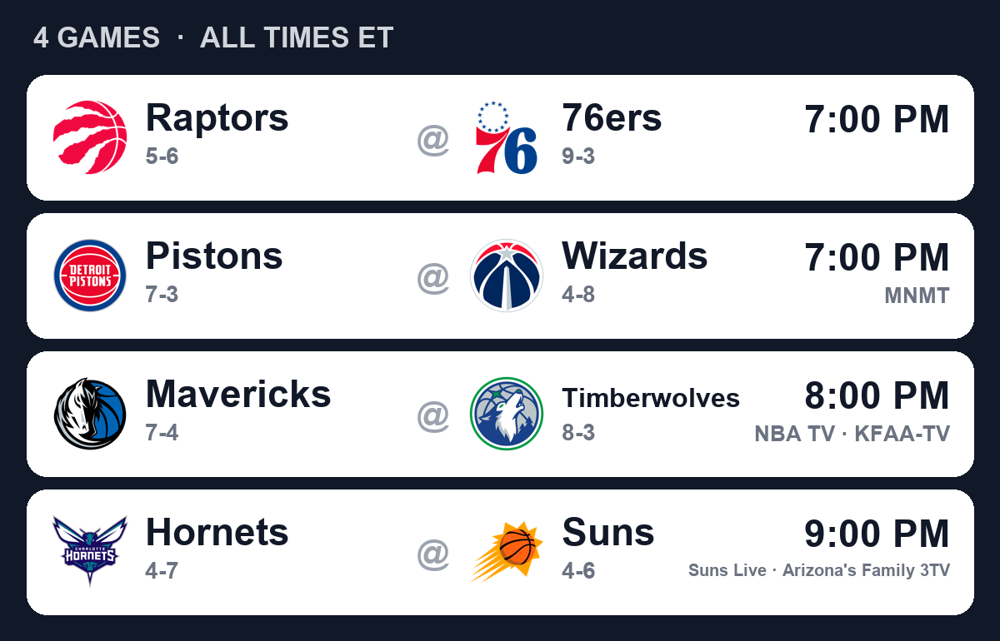
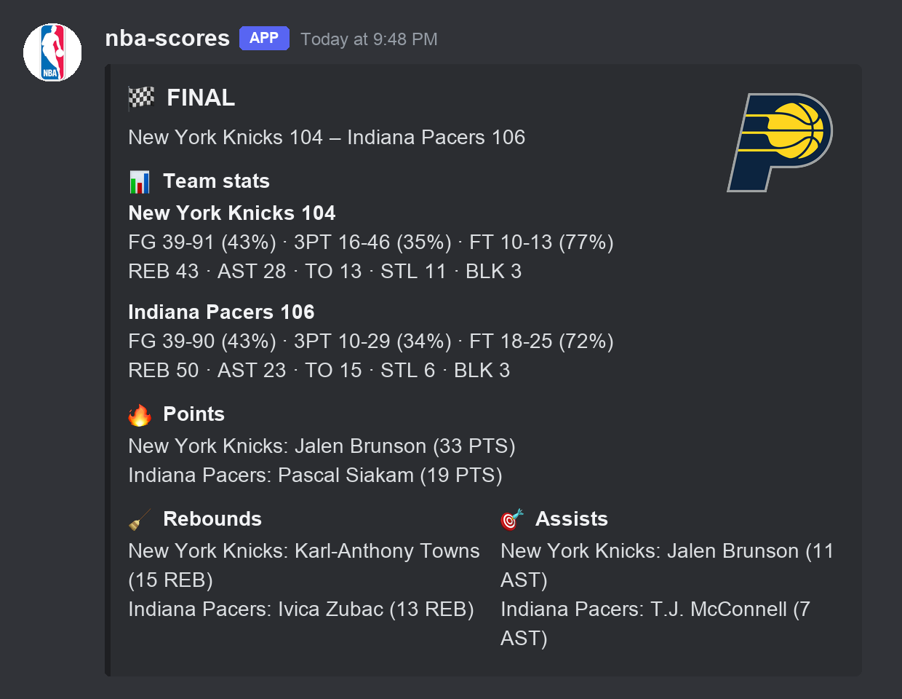

# NBA Score Discord Integration

A Discord bot that posts NBA final scores, a nightly recap, and a daily schedule card with team logos, using data from ESPN's public API. It runs entirely on GitHub Actions, so there is no server to host.

<table>
  <tr>
    <th>Daily schedule</th>
    <th>Final score</th>
  </tr>
  <tr>
    <td></td>
    <td></td>
  </tr>
</table>

## What it posts

| Post | When | What's in it |
| --- | --- | --- |
| 📅 **Daily schedule** | 9:00 AM Pacific on game days | An image with every matchup, team logos, records, tip times (ET) and TV channels |
| 🏁 **Final score** | When each game ends | Final score, winner's logo, team stats (FG, 3PT, FT, REB, AST, TO, STL, BLK) and each team's points, rebounds and assists leaders |
| 🌙 **Nightly recap** | After the last game of the night | Every final score plus awards for the night's top performers in points, rebounds, assists, blocks and steals |

## How it works

The workflow in [`.github/workflows/nba-poll.yml`](.github/workflows/nba-poll.yml) starts a run a few times a day. Each run stays alive for up to about 5½ hours and:

1. Waits until 9:00 AM Pacific and posts the day's schedule.
2. Checks each game about **2h15m after tip-off** (roughly how long an NBA game lasts), then every 5 minutes until it is final, and posts the final score.
3. Posts the nightly recap once every game is done.
4. Starts a fresh run to take over if there are still games to check when its time runs out.

Between checks the run sleeps, so it makes very few requests to ESPN. GitHub Actions is free for public repositories.

What has already been posted is saved in [`bot_state.json`](bot_state.json), which each run commits back to the repo. That way nothing is posted twice, and a final is never posted for a game that tipped off more than 12 hours ago.

## Setup

1. **Create a Discord bot** in the [Discord Developer Portal](https://discord.com/developers/applications) and copy its token.
2. **Invite it to your server** with the **Send Messages**, **Embed Links** and **Attach Files** permissions. Attach Files is needed for the schedule image; without it the bot falls back to a plain-text schedule.
3. **Get the channel ID**: turn on Developer Mode in Discord, then right-click the channel → **Copy Channel ID**.
4. **Add repository secrets** under Settings → Secrets and variables → Actions:
   - `DISCORD_TOKEN`: the bot token
   - `CHANNEL_ID`: the channel ID
5. **Start it**: the schedule runs automatically. To start a run right away, go to Actions → **NBA score poll** → **Run workflow**.

## Configuration

These settings are near the top of [`nba_score_bot.py`](nba_score_bot.py):

| Setting | Default | Meaning |
| --- | --- | --- |
| `SCHEDULE_HOUR_PT` | `9` | Hour (Pacific time) the daily schedule is posted |
| `GAME_LENGTH` | 2h15m | How long after tip-off a game is first checked |
| `RECHECK_EVERY` | 5 min | How often an unfinished game is rechecked after that |
| `FINAL_WINDOW` | 12h | Finals for games older than this are never posted |
| `WATCH_MAX` | 5h30m | How long one GitHub Actions run stays alive |

GitHub's schedule uses UTC. The cron times in the workflow are set so a run is already going before 9:00 AM Pacific, in both standard and daylight time.

## Running it locally (for testing)

```bash
pip install -r requirements.txt
```

Create a `.env` file with:

```
TOKEN=your-bot-token
CHANNEL_ID=your-channel-id
```

Then run:

```bash
python nba_score_bot.py
```

This does exactly what one GitHub run does, and posts to the real channel. Don't run it while the GitHub workflow is active: your local `bot_state.json` would differ from the one on GitHub, and posts would be duplicated.

## Files

- `nba_score_bot.py`: the bot
- `.github/workflows/nba-poll.yml`: the GitHub Actions schedule
- `bot_state.json`: what has been posted (updated automatically)
- `requirements.txt`: Python dependencies (`discord.py`, `requests`, `python-dotenv`, `Pillow`)

## License

[MIT](LICENSE)
